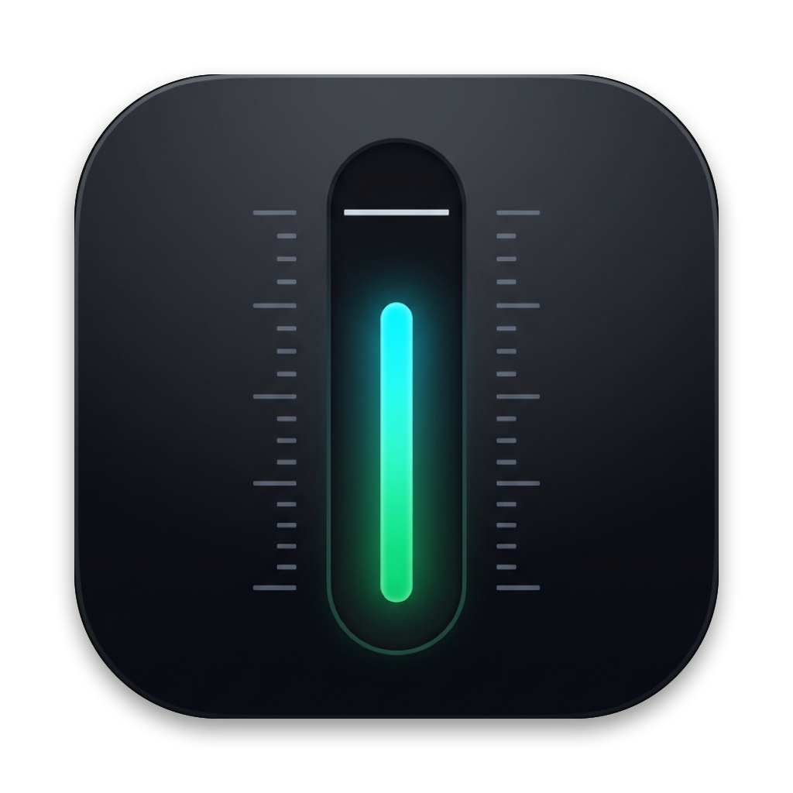

<p align="center">
  
</p>

<h1 align="center">Headroom</h1>

<p align="center">
  <strong>Know what's left — not just what's spent.</strong><br />
  Native macOS menu bar &amp; CLI telemetry for AI coding quotas, burn rate, and reset pacing.
</p>

<p align="center">
  <a href="https://github.com/JustinBeaudry/Headroom/actions/workflows/release.yml">
    
  </a>
  <a href="https://github.com/JustinBeaudry/Headroom/releases/latest">
    
  </a>
  
  
  
</p>

---

## Why Headroom?

Showing **"64% used"** isn't enough on its own. **Headroom** compares **% of quota used** against **% of reset window elapsed** so you immediately know whether you're **in reserve** or **burning fast** (projected to hit the wall before reset) across all five major AI coding ecosystems:

- **Zero-WebView Native macOS:** Pure Swift 6 + SwiftUI `MenuBarExtra` (~15–25 MB RAM), native Keychain storage, and `UNUserNotificationCenter` alerts.
- **Decoupled Local Weather Station:** `HeadroomCore` polls providers, caches normalized JSON state, and feeds both the menu bar app and the `headroom` CLI without duplicate auth or polling.
- **Zero-Password / Session-Reuse Auth:** Automatically reuses existing CLI OAuth caches (`~/.claude`, `~/.codex`, `~/.gemini`, Cursor `state.vscdb`) and stores opt-in browser session cookies or API keys in macOS Keychain.
- **Unified X Subscription Deduplication:** Detects Cursor `isUnified` / `SAND_BILLING_BRAND_GROK` via `GetSandUsageStatus` and links Cursor + Grok into a single shared weekly pool while preserving separate 3rd-party API spend caps and xAI prepaid credits.
- **Adaptive Polling & Fault Isolation:** Polls every 90s while you're actively coding, backs off to 20m when idle, and isolates per-provider errors with exponential backoff so one expired cookie never blocks the other four.

---

## Supported Providers

| Provider | Primary Auth / Data Source | Tracked Windows | Special Handling |
| --- | --- | --- | --- |
| **Claude** | `claude.ai` session cookie + Claude Code OAuth + `~/.claude/projects` JSONL fallback | 5h rolling session, weekly cap, optional extra-usage `$` | Captures shared web + CLI quota with cookie; deduplicates streaming JSONL chunks for local cost estimation. |
| **Codex** | `~/.codex/auth.json` OAuth + optional OpenAI session cookie + `OPENAI_API_KEY` | 5h / weekly subscription windows + PAYG API spend | Separates ChatGPT/Codex subscription windows from pay-as-you-go OpenAI API credits. |
| **Cursor** | Local `state.vscdb` Bearer JWT (Connect-RPC `GetSandUsageStatus` & `GetCurrentPeriodUsage`) or web cookie | Unified X weekly pool + additional/3rd-party spend cap, or legacy monthly pool | Auto-detects `isUnified` / `SAND_BILLING_BRAND_GROK` so X Subscription accounts don't falsely read legacy monthly fields. |
| **Grok** | `grok.com/dashboard` session cookie + optional `XAI_API_KEY` (`api.x.ai`) | Shared weekly pool `%` + prepaid xAI API credits | Automatically links & deduplicates with unified Cursor accounts into one **X Subscription Weekly Pool**. |
| **Gemini** | `~/.gemini/oauth_creds.json` + local CLI logs + GCP `cloudaicompanion.googleapis.com` + `GEMINI_API_KEY` | Daily CLI requests, GCP Code Assist quota, or API daily budget | Explicit lane toggle (`auto`, `cli`, `gcp_quota`, `api_key`). |

---

## Installation

### Option 1: Download Prebuilt Release (Recommended)

Every push to `main` automatically runs tests, bundles `Headroom.app` (with native icon & embedded CLI), and publishes a new version to [**GitHub Releases**](https://github.com/JustinBeaudry/Headroom/releases/latest):

1. Download **`Headroom-vX.Y.Z-macos-arm64.dmg`** (or `.zip`) from the [Latest Release](https://github.com/JustinBeaudry/Headroom/releases/latest).
2. Drag **Headroom.app** into `/Applications` and launch it.
3. *(Optional)* Symlink the bundled CLI into your `PATH`:
   ```bash
   sudo ln -sf /Applications/Headroom.app/Contents/Helpers/headroom /usr/local/bin/headroom
   ```

### Option 2: Build from Source

```bash
git clone https://github.com/JustinBeaudry/Headroom.git
cd Headroom

# Run unit tests
swift test

# Build & package dist/Headroom.app (includes AppIcon.icns + bundled CLI)
./scripts/bundle-app.sh
open dist/Headroom.app
```

---

## Quick Start

### 1. Preview Instantly with Demo Telemetry

```bash
swift run headroom status --demo
```

```text
Headroom — AI Quota & Pace Telemetry
────────────────────────────────────────────────────────────────────────

[X Subscription Weekly Pool] (Cursor + Grok • personal)
    X Weekly Pool (Shared)   [████████░░░░░░░░]  52% left  [On Track]      reset 3d 13h
    + Cursor 3rd-Party API Cap: [████░░░░░░░░] $18.50 / $50.00
    + Grok xAI Prepaid Credits: [███░░░░░░░░░] $6.40 / $25.00

[Codex] (personal) — OK | local ~$9.85
    5h Session               [█████████████░░░]  16% left  [Burning Fast]  reset 2h 9m (⚠ runs out in ~32m)
    Weekly Cap               [████████░░░░░░░░]  48% left  [Burning Fast]  reset 3d 23h (⚠ runs out in ~2d 18h)

[Claude] (personal) — OK | local ~$14.20
    5h Session               [██████████░░░░░░]  36% left  [Burning Fast]  reset 3h 24m (⚠ runs out in ~53m)
    Weekly Cap               [███████░░░░░░░░░]  59% left  [In Reserve]    reset 3d 5h

[Gemini] (personal) — OK | local ~$2.15
    Daily Requests (CLI)     [███░░░░░░░░░░░░░]  78% left  [In Reserve]    reset 9h 29m
```

### 2. Inspect Discovered Local Sessions & Connect Cookies

```bash
# Probe local CLI logs, OAuth caches, and Cursor state DB
headroom doctor
headroom auth status

# Store opt-in browser session cookies or API keys in macOS Keychain
headroom auth set claude --kind cookie
headroom auth set grok --kind cookie
headroom auth set cursor --kind cookie

# Estimate local CLI token & USD spend across the last 7 days
headroom costs --days 7
```

---

## CLI Reference

| Command | Description |
| --- | --- |
| `headroom status [--json] [--provider <name>] [--account <label>] [--cached] [--demo]` | Show normalized headroom, burn-rate pace, and reset countdowns |
| `headroom poll [--provider <name>] [--json]` | Force an immediate live poll across providers |
| `headroom pools [--json] [--demo]` | View linked shared pools (e.g., X Subscription Cursor + Grok) |
| `headroom costs [--days <n>] [--json]` | Estimate local CLI token & USD spend from Claude / Codex / Gemini logs |
| `headroom auth status \| set \| clear` | Inspect discovered credentials or manage Keychain secrets |
| `headroom config show \| init \| add-account \| set-gemini-lane` | Manage multi-account (`personal` / `work`) config and Gemini lane |
| `headroom daemon [--once]` | Run the adaptive polling daemon headless |
| `headroom doctor` | Verify local cache paths and CLI/editor integrations |

### Normalized JSON Schema (`headroom status --json`)

```json
{
  "provider": "claude",
  "account_label": "personal",
  "status": "ok",
  "windows": [
    {
      "id": "session_5h",
      "label": "5h Session",
      "unit": "percent",
      "used": 64.0,
      "limit": 100.0,
      "resets_at": "2026-11-23T22:00:00Z",
      "window_duration_sec": 18000,
      "pace_status": "burning_fast"
    }
  ]
}
```

---

## Menu Bar Features

- **Two Menu Bar Styles:** Toggle between **Most Urgent Limit** (compact `CDX 16%` capsule with pace glyph) and **Mini Stacked Bars** for all tracked pools.
- **Dual-Track Pace Bars:** Every quota bar renders a vertical **elapsed-time tick mark** so you can visually compare burn vs. time elapsed at a glance.
- **Screen-Share Privacy Mode:** One-click eye toggle hides account labels, exact percentages, and spend figures during calls or demos.
- **Native Notifications:** Deduplicated alerts for low headroom (`<= 20%`), projected exhaustion before reset, window resets, and expired cookies.

---

## Project Architecture

```text
Headroom/
├── Assets/AppIcon.png                 # Master 1024x1024 macOS app icon
├── VERSION                            # Base major.minor.patch version for auto-releases
├── scripts/bundle-app.sh              # Builds Headroom.app, AppIcon.icns, .dmg, .zip, CLI tarball & SHA256SUMS
├── .github/workflows/release.yml      # Tests & publishes a new GitHub Release on every push to main
├── Sources/
│   ├── HeadroomCore/                  # Data models, pacing engine, Keychain/JSON stores, 5 adapters, pool linker, poller, alerts
│   ├── headroom/                      # CLI executable
│   └── HeadroomApp/                   # Native SwiftUI MenuBarExtra app & Settings
└── Tests/HeadroomCoreTests/           # Offline unit & regression test suite
```

---

## Automated Versioning & Releases

Every push to `main` triggers [`.github/workflows/release.yml`](.github/workflows/release.yml) on `macos-15`:

1. Runs `swift test` — releases are only cut when all tests pass.
2. Reads [`VERSION`](VERSION) (`MAJOR.MINOR.PATCH`) and automatically increments the patch number above the latest matching `vMAJOR.MINOR.*` Git tag (to cut a new minor/major version, bump `VERSION` and push).
3. Builds release binaries, generates `AppIcon.icns`, packages `Headroom-vX.Y.Z-macos-arm64.dmg`, `Headroom-vX.Y.Z-macos-arm64.zip`, `headroom-cli-vX.Y.Z-macos-arm64.tar.gz`, and `SHA256SUMS.txt`.
4. If Apple signing secrets are configured, signs both binaries and the DMG with **Developer ID Application** (Hardened Runtime + timestamp), submits to Apple `notarytool`, and staples the notarization ticket.
5. Tags `vX.Y.Z` and publishes a new **GitHub Release** with auto-generated release notes.

### Code Signing & Apple Notarization Secrets

To mint signed, notarized releases automatically in GitHub Actions, set these 5 repository secrets:

| Secret | Value |
| --- | --- |
| `APPLE_CERT_BASE64` | Base64-encoded `.p12` export of your **Developer ID Application** certificate (`base64 -i DevID.p12 \| pbcopy`) |
| `APPLE_CERT_PASSWORD` | Password used when exporting the `.p12` |
| `APPLE_ID` | Your Apple Developer account email |
| `APPLE_TEAM_ID` | Your 10-character Apple Developer Team ID |
| `APPLE_APP_SPECIFIC_PASSWORD` | App-specific password generated at `account.apple.com` |
